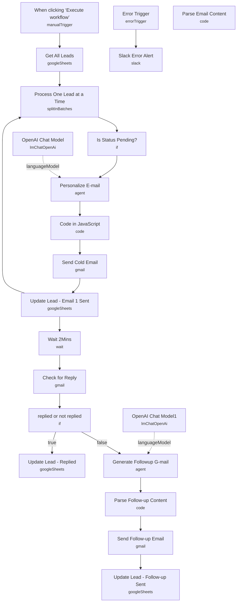

# Cold Email Outreach Automation

[](https://github.com/Redsf/cold-email-outreach-engine/actions/workflows/validate.yml)

> Standalone reference build, pulled out of my [59-workflow n8n portfolio](https://github.com/Redsf/n8n-workflows). Credential-free — no secrets, API keys, or client data included.
>
> Full write-up (strategy, architecture, results) in the case study: [Redsf/cold-email-engine-saas →](https://github.com/Redsf/Redsf/blob/main/case-studies/cold-email-engine-saas.md)

A full cold-outreach sequencer that reads leads from Google Sheets, writes a personalized first-touch email with an LLM, sends it via Gmail, waits, checks the same thread for a reply, and — if there's no reply — generates and sends a follow-up email automatically. Every step updates lead status back in the source spreadsheet.

Built for a small sales or agency team running one-person cold email campaigns who want personalized, on-brand outreach without manually tracking replies in a CRM.

## Production results

From the production deployment of this architecture (B2B SaaS, outbound sales):

| Metric | Result |
|---|---|
| Manual outreach effort | **−87%** |
| Open rate / reply rate | **28% / 8%** |
| Qualified meetings booked | **10–12 per month** |

Full breakdown: [case study →](https://github.com/Redsf/Redsf/blob/main/case-studies/cold-email-engine-saas.md)

## Read this before you send anything

This workflow sends email to strangers on your behalf. Two things in it are
demo-grade and will cause real damage if you activate it as shipped:

1. **The sign-off is a placeholder.** `Your Name / Your Company / Your City` is
   baked into both agent prompts and both Code nodes' HTML templates. Sending
   that to a prospect is unrecoverable per recipient.
2. **There is no opt-out line and no suppression list.** Both are required —
   see [Compliance](#compliance) below.

The [eval suite](evals/) checks for exactly these before a send. Run it first.

## What it does

1. **When clicking 'Execute workflow'** kicks off the run.
2. **Get All Leads** (Google Sheets) reads every row from the leads spreadsheet.
3. **Process One Lead at a Time** (Split In Batches) processes leads one by one.
4. **Is Status Pending?** (IF) checks whether the lead's `Status` column equals `"Pending"`; only pending leads continue.
5. **Personalize E-mail** (LangChain Agent, backed by **OpenAI Chat Model** on GPT-5-mini) writes a personalized cold email as structured JSON (subject, greeting, opening line, pain point, value proposition, CTA, fixed sign-off) based on the lead's name, company, role and industry.
6. **Code in JavaScript** parses the agent's JSON output (with regex fallback if parsing fails) and renders both a plain-text and a styled HTML version of the email.
7. **Send Cold Email** (Gmail) sends the HTML email to the lead's address.
8. **Update Lead - Email 1 Sent** (Google Sheets) writes back the thread ID, status ("Email 1 Sent") and send date, matched on the lead's email address.
9. From there the workflow branches into a loop-continuation path (back to **Process One Lead at a Time**) and a reply-check path:
10. **Wait 2Mins** pauses before checking for a reply (a placeholder interval — in production this would typically be hours or days).
11. **Check for Reply** (Gmail) searches the inbox for a reply on the same `Thread_ID`.
12. **replied or not replied** (IF) branches on whether any reply items were returned.
    - If a reply exists: **Update Lead - Replied** (Google Sheets) marks the lead `Status = "Replied"`, records the reply date and schedules a follow-up date.
    - If no reply: **Generate Followup G-mail** (LangChain Agent, backed by **OpenAI Chat Model1**) writes a fresh-angle follow-up email (never references the first email directly) as structured JSON.
13. **Parse Follow-up Content** (Code) parses that JSON and builds the plain-text and HTML follow-up email.
14. **Send Follow-up Email** (Gmail) sends the follow-up to the lead.
15. **Update Lead - Follow-up Sent** (Google Sheets) marks the lead `Status = "Follow Up Sent"` with the send date.

A disabled legacy branch (**Parse Email Content**, feeding nothing) and a disabled **Error Trigger** → **Slack Error Alert** pair are also present in the canvas but not active in the current flow (see Error handling below).

## Setup (about 15 minutes)

1. **Google Sheets** — connect Google Sheets OAuth2 in **Get All Leads**, **Update Lead - Email 1 Sent**, **Update Lead - Replied** and **Update Lead - Follow-up Sent**. Point each at your own leads sheet by replacing the `REPLACE_WITH_SPREADSHEET_ID` placeholder, keeping the columns: `E-mail`, `First_Name`, `Last_Name`, `Company`, `Job_Title`, `Industry`, `Status`, `Email_Sent_Date`, `Thread_ID`, `Reply_Date`, `Followup_Date`. Add a `Suppressed` column too — see [Compliance](#compliance).
2. **Gmail** — connect Gmail OAuth2 in **Send Cold Email**, **Check for Reply** and **Send Follow-up Email**. Update the hardcoded `replyTo` address (`you@example.com`) in **Send Cold Email** to your real sending address.
3. **OpenAI** — add your API key in **OpenAI Chat Model** and **OpenAI Chat Model1** (both GPT-5-mini).
4. **Sender details** — the email copy is generated with a placeholder sign-off ("Your Name / Your Company / Your City") baked directly into both the AI agent prompts and the Code nodes' HTML templates (**Code in JavaScript**, **Parse Follow-up Content**). Replace these with your own sender name, company and contact details before using this in production.
5. **Wait interval** — the **Wait 2Mins** node uses a 2-minute delay for demo purposes; increase this to a realistic follow-up window (e.g. 2–3 days) for real campaigns.

## Compliance

Automated outbound is regulated. The workflow as shipped does not implement any
of this — it is the operator's responsibility, and it is not optional.

**Required before any real campaign:**

| Requirement | What it means here | Applies under |
|---|---|---|
| **Identify the sender** | Real name, real company, real physical postal address in every email. The placeholder sign-off does not satisfy this. | CAN-SPAM (US), PECR (UK) |
| **Working opt-out** | A clear opt-out in every message, honoured within 10 business days. Add a suppression column to the leads sheet and check it in **Is Status Pending?**. | CAN-SPAM, GDPR, PECR |
| **No misleading subject or headers** | The subject must reflect the body. LLM-written subject lines drift — the eval suite flags shouty and truncated ones. | CAN-SPAM |
| **Lawful basis (EU/UK B2B)** | Legitimate interest requires the contact to be relevant to their professional role, plus a documented balancing test. Scraped consumer addresses do not qualify. | GDPR Art. 6(1)(f) |
| **Right to erasure** | A deletion request must remove the lead from the sheet *and* the suppression logic must keep them out of future imports. | GDPR Art. 17 |
| **Data minimisation** | Only store lead fields you actually use. This workflow needs six. | GDPR Art. 5(1)(c) |

**Operational guardrails, on top of the legal minimum:**

- **Warm the domain.** Send from a dedicated domain, ramp volume over weeks. A cold domain at volume burns deliverability for every future campaign.
- **Respect send limits.** Gmail caps daily sends per account. Above the cap you need a dedicated ESP, not more `Wait` nodes.
- **Set the follow-up interval to something real.** **Wait 2Mins** is a demo value. Two minutes between a first touch and a follow-up reads as a malfunction.
- **Cap follow-ups.** This workflow sends one. Do not extend it into an indefinite sequence without an exit condition.
- **Suppress on reply, bounce, and complaint** — not just on reply.

This is not legal advice. Rules differ by jurisdiction and by whether your
recipients are businesses or individuals. Get the campaign reviewed before it
runs at volume.

## Evals

This repo ships an **eval harness** ([evals/](evals/)) — 12 lead fixtures graded
on deliverability, personalization, compliance, and fabrication before anything
reaches a real inbox.

The deterministic checks need no API key and run in under a second:

```bash
python evals/run_eval.py --emails emails.jsonl --no-judge
```

Three checks are blocking: placeholder leak, missing opt-out, empty subject.
They are pure string work — port them into a Code node ahead of **Send Cold
Email** and route failures to review instead of to Gmail.

The one check that needs a model is fabrication: given four fields about a lead,
an LLM will assert funding rounds, headcounts, and pain points it has no source
for. That is the failure that lands in a stranger's inbox with your name on it.

## Cost model

Per-lead cost, cost per booked meeting, and the reply rate below which the
channel stops being worth running: [docs/cost-model.md](docs/cost-model.md).

Short version: tokens cost single-digit dollars per month at 1,000 leads. Domain
reputation and deliverability are the real costs, and they are not on any
invoice.

## Error handling

An **Error Trigger** → **Slack Error Alert** pair exists on the canvas to post workflow failures to Slack, but both nodes are disabled, so no error notifications currently fire. Enable them and configure the Slack OAuth2 credential to get live alerts on failures. There is also a disabled, unused **Parse Email Content** node left over from an earlier version of the email-parsing logic — safe to remove during cleanup.

CI reports both of these on every push — see the `validate` badge above.

---

<!-- ARCHITECTURE:START -->
## Architecture


<!-- ARCHITECTURE:END -->
